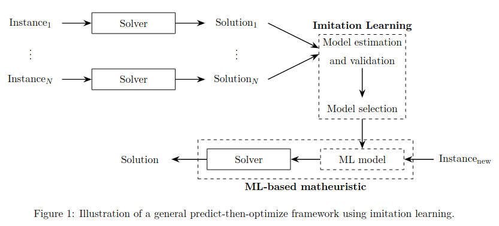

# MLforCO — Machine Learning for Combinatorial Optimization

**A feasibility-aware predict-then-optimize matheuristic for multi-item capacitated lot sizing.**

## Overview

MLforCO studies how supervised learning can support mathematical optimization in repeated production-planning decisions. Its implemented problem is the **Multi-item Capacitated Lot-Sizing Problem (MCLSP)**: determine production quantities, inventories, and setup decisions for several items over a finite planning horizon, meeting demand under shared production capacity while minimizing production, holding, and setup costs.

Binary setup decisions couple discrete choices with continuous production and inventory decisions. As the number of items and periods grows, the resulting mixed-integer linear program (MILP) presents a large combinatorial search space. The project learns setup decisions from solver-generated examples, then uses predicted probabilities to restrict subsequent MILPs. An auxiliary optimization model repairs infeasible predictions before the restricted problem is solved.

This connects **Machine Learning, Operations Research, and Decision-Making** through a concrete division of responsibilities: classifiers predict useful discrete decisions, while mathematical programming enforces the production-planning constraints and determines quantities. Reducing the discrete search may improve computational efficiency, with a possible loss in solution quality. The repository provides an experimental pipeline for studying that tradeoff; it does not establish a general performance guarantee.

## Methodology

The active implementation follows four phases configured in [config.py](config.py).

1. **Generate instances.** Sample production costs, holding costs, demand, setup costs, and period capacities using a configured random seed. Generate training and test collections separately, then retain the configured instance IDs.
2. **Solve and label.** Use Gurobi to solve the unrestricted MCLSP, its continuous setup relaxation, and a callback-based root-node relaxation procedure. Store decision variables, features, objective values, and solver metrics in Excel files. Training labels are rounded values of the unrestricted solver's `y_pre` setup decisions. Because solves have work limits, these labels need not always represent proven optima.
3. **Train and validate.** Train probabilistic binary classifiers on item-period observations, keeping whole instances together in splits. Sample hyperparameter configurations, evaluate them with instance-level cross-validation and an optimization-based feasibility-aware score, and save each fitted classifier together with its scaler.
4. **Predict, repair, and optimize.** On test instances, predict setup probabilities and apply the configured threshold and fixing strategy. If fixing produces an infeasible problem, solve an auxiliary MILP to activate selected predicted-zero setups and retry the restricted MCLSP. Save per-instance comparisons against the unrestricted solver baseline.

### Offline learning and online optimization

The offline stage generates examples, obtains solver labels and relaxation features, and fits model/scaler pairs. This is **supervised imitation learning**: the learner imitates setup decisions found by mathematical optimization.

The online procedure applies a saved pair to an unseen instance, fixes setup variables, repairs feasibility when needed, and determines production and inventory through optimization. Relaxation-based feature sets require additional solver work at inference time. The current evaluation script is a batch experiment: it reads test features and baseline solutions precomputed in phase 2, rather than exposing a standalone inference service. Hyperparameters are selected separately for every classifier/feature combination; the pipeline evaluates the configured models without automatically choosing one overall deployment model.

## Methodology figure



*Figure 1. General predict-then-optimize framework using imitation learning. MLforCO instantiates this workflow with setup classification, MILP variable fixing, and optimization-based feasibility repair.*

## Machine Learning methods

The active training script, [03_train_model.py](03_train_model.py), supports the following scikit-learn classifiers. Each estimates the probability that a setup variable should equal one.

| Configuration name | Implemented method | Role in the workflow |
|---|---|---|
| `DT` | Decision tree | Predict setup activation through learned feature splits. |
| `RF` | Random forest | Aggregate setup predictions from an ensemble of trees. |
| `KNN` | K-nearest neighbors | Estimate setup classes using neighboring feature observations. |
| `SVM` | Support vector classification (`SVC`, probability estimation enabled) | Learn nonlinear setup classifiers using RBF or polynomial kernels. |
| `NB` | Gaussian Naive Bayes | Estimate setup probabilities using class-conditional feature distributions. |

### Features and model selection

| Feature family | Columns | Information source |
|---|---|---|
| `A` | `Costo_Produccion`, `Costo_Inventario`, `Demanda`, `Costo_Setup` | Original item-period problem parameters. |
| `B` | `x_relaxed`, `s_relaxed`, `y_relaxed` | Continuous setup relaxation. |
| `B_hat` | `x_relaxed_rootnode`, `s_relaxed_rootnode`, `y_relaxed_rootnode` | Relaxation values collected at the root node of Gurobi's MIP search. |

Training covers `A`, `B`, `B_hat`, `A+B`, and `A+B_hat`; matheuristic evaluation covers the three individual families. Capacity is retained for optimization-based scoring but is not a predictor in these feature lists.

The active wrappers reserve 25% of the training-instance IDs as an internal holdout, using `random_state=42`. With the supplied 12 training instances, this gives nine fitting instances and three holdout instances. `LeaveOneGroupOut` cross-validation groups observations by `Instancia`, and `StandardScaler` is fitted only on each fold's fitting data. `ParameterSampler` samples up to `ML_CONFIG['N_iter']` hyperparameter configurations, currently 50, using seed 42.

Fold scores come from `vars_a_levantar_train`: two auxiliary optimization solves repair and evaluate setup predictions, then measure agreement with solver labels excluding the first period. Parameter selection minimizes the nonzero coefficient of variation (`standard deviation / mean`) of these scores, with a fallback to the first candidate. It is therefore a stability-based selection rule, rather than selection by highest mean classification accuracy. The final model and scaler are fitted on the fitting-instance subset and scored on the internal holdout.

[functions.py](functions.py) also contains XGBoost and gradient boosting classification wrappers, feature expansion, ANOVA-based `SelectKBest`, class resampling, and correlation/plotting utilities. These helpers are outside the numbered pipeline. The legacy logistic regression wrapper references an undefined `train_instances` variable and requires repair before use. Adding a wrapper to the active workflow also requires compatible dispatch and artifact handling in phases 3 and 4.

## Optimization methods

The implemented MCLSP uses continuous nonnegative production `x[t,j]` and inventory `s[t,j]`, and binary setup variables `y[t,j]`. Its objective minimizes the sum of production, inventory, and setup costs. Constraints enforce inventory balance, shared production capacity, and production/setup linking (`x[t,j] <= capacity[t] * y[t,j]`). Initial inventory is implicitly zero; final inventory is fixed to zero; each item's first-period setup is fixed to one.

| Method | Implementation and purpose |
|---|---|
| Unrestricted MILP | `optimal` generates setup labels and the reference production plan using Gurobi's MIP search. Branch-and-bound/cut processing is supplied by the solver. |
| LP relaxation | `optimal_relaxed_binary` replaces binary setup domains with `[0,1]`, generating family `B`. |
| Root-node relaxation | `optimal_root_node` collects `MIPNODE` relaxation values at node zero and terminates after a non-root node callback, generating family `B_hat`. |
| Learning-guided restricted MILP | `optimal_predict_threshUP` fixes setup variables from classifier probabilities, then solves for a production plan. |
| Feasibility repair | `vars_a_levantar` keeps above-threshold setups active and uses penalized lifting variables to activate selected below-threshold setups. Its `SolutionLimit=1` requests a first feasible repair, rather than proving a minimum-change repair. |

`EVALUATION_CONFIG` currently uses threshold `0.5` and fixes both predicted zeros and ones. Strategies fixing only zeros or only ones are exposed by `zeroOrOne`. Repair changes selected predicted-zero setups to one. It is an optimization-based repair procedure, rather than an independently implemented constructive heuristic.

Older functions implement solver hints, warm starts, alternative fixing rules, and relaxation/prediction variants. They remain exploratory alternatives in `functions.py` and are not executed by the four-phase workflow.

## Python libraries and technical stack

Packages below are verified against source imports or the pipeline's Excel I/O. Standard-library modules provide argument parsing, subprocess orchestration, seeded generation, filesystem operations, timing, and pickle serialization.

| Category | Python package / Technology | Purpose |
|---|---|---|
| Machine Learning | [scikit-learn](https://scikit-learn.org/stable/) | Active classifiers, scaling, instance splits, hyperparameter sampling, and validation; additional exploratory feature/model utilities. |
| Machine Learning | [XGBoost](https://xgboost.readthedocs.io/en/stable/) | Additional classification wrapper; imported unconditionally by `functions.py`, although absent from the active model list. |
| Mathematical Optimization | [Gurobi / gurobipy](https://docs.gurobi.com/projects/optimizer/en/current/) | MCLSP formulations, LP relaxations, MIP callbacks, variable fixing, and feasibility repair. |
| Scientific Computing | [NumPy](https://numpy.org/doc/), [SciPy](https://docs.scipy.org/doc/scipy/) | Numeric arrays, hyperparameter ranges, validation statistics, and Spearman correlation in an exploratory helper. |
| Data Processing | [pandas](https://pandas.pydata.org/docs/), [openpyxl](https://openpyxl.readthedocs.io/en/stable/) | DataFrames and `.xlsx` instance, solution, parameter, and metric exchange; openpyxl supplies the Excel-reading engine. |
| Visualization | [Matplotlib](https://matplotlib.org/stable/), [Seaborn](https://seaborn.pydata.org/) | Diagnostic plots, feature scores, and correlation heatmaps in shared helpers. |
| Research documents | [pdfplumber](https://github.com/jsvine/pdfplumber) | PDF text extraction in `documents/extraer_pdfs.py`; optional for the experiment pipeline. |

## Repository structure

```text
MLforCO/
├── main.py                        # CLI orchestrator for one phase or all phases
├── config.py                      # Experiment identity, settings, features, and paths
├── 01_generate_instances.py        # Training/test instance and metadata generation
├── 02_solve_optimal.py             # Unrestricted solves, relaxations, and reference metrics
├── 03_train_model.py               # Classifier training and model/scaler persistence
├── 04_evaluate_matheuristic.py     # Restricted MILP evaluation against reference solves
├── functions.py                   # Optimization, repair, ML, and exploratory helpers
├── README.md
├── context.md                     # Implementation notes and known limitations
├── AGENTS.md                      # Contribution and experiment-consistency instructions
├── .gitignore
├── docs/images/
│   └── imitation_learning_framework.png
├── documents/                     # Manuscript, roadmap, extracted text, and PDF utility
└── results_exp0/
    ├── data/{train,test}/          # Retained instance tables and metadata
    ├── data/optimal/               # Reference variables, relaxation features, and metrics
    ├── models/                    # Retained classifier artifact
    ├── scalers/                   # Matching fitted scaler
    └── params/                    # Retained hyperparameter-selection record
```

The retained experiment artifacts total approximately 7.3 MiB. New experiment outputs are ignored by Git; the existing tracked data, model/scaler pair, and parameter record are preserved. `PATHS['results']` points to `results_exp0/results`, which phases 3 and 4 create when writing consolidated metrics; it is not part of the supplied artifact snapshot.

## Installation

The review used **Python 3.10.12**. There is no dependency manifest or complete environment lockfile, and other interpreter/library combinations have not been validated. The following Unix-shell setup uses the packages identified in the implementation:

```bash
git clone https://github.com/FrancoQuezada/MLforCO.git
cd MLforCO
python3 -m venv .venv
source .venv/bin/activate
python3 -m pip install pandas numpy scipy matplotlib seaborn openpyxl xgboost gurobipy "scikit-learn==1.4.2"
```

The retained decision tree and scaler both record **scikit-learn 1.4.2** in their pickle metadata, which motivates that version in the command. Other original dependency versions are not recorded, so this is not an exact reconstruction of the training environment. Follow scikit-learn's [model persistence guidance](https://scikit-learn.org/stable/model_persistence.html) when reusing artifacts across environments, or regenerate a matching model/scaler pair in your chosen environment.

**Gurobi is a commercial solver and a valid license covering the configured problem sizes is required.** Installing `gurobipy` does not provision a full license. Consult the official [Python installation and licensing guidance](https://support.gurobi.com/hc/en-us/articles/360044290292-How-do-I-install-Gurobi-for-Python).

For the optional PDF extraction utility:

```bash
python3 -m pip install pdfplumber
python3 documents/extraer_pdfs.py
```

This utility rewrites the extracted `.txt` files beside the source PDFs.

## Usage

Run from the repository root. The CLI executes phases sequentially and stops if a phase fails:

```bash
python3 main.py --help
python3 main.py generate
python3 main.py solve
python3 main.py train
python3 main.py evaluate
```

To run all four phases:

```bash
python3 main.py all
```

The original scripts are equivalent entry points:

```bash
python3 01_generate_instances.py
python3 02_solve_optimal.py
python3 03_train_model.py
python3 04_evaluate_matheuristic.py
```

Phases write files using the settings in `config.py` and can overwrite matching existing outputs. Keep a separate experiment directory when changing settings. `EXPERIMENT_ID` controls output directories; `TRAIN_PARAMS`, `TEST_PARAMS`, `ML_CONFIG`, and `EVALUATION_CONFIG` control instance selection, features, model lists, thresholds, and budgets. `COST_RANGES` records the generator's ranges, but those values are currently hardcoded inside `crear_base_datos`; editing that dictionary alone does not change generation.

Instance and reference filenames follow `{artifact}_{split}_n{items}_p{periods}_c{c}_f{f}_s{seed}.xlsx`. Model/scaler filenames additionally include the model, feature combination, and ordered feature columns. Evaluation loads pairs identified by the **training** parameters and applies them to instances identified by the test parameters.

The included artifacts provide phase-1/phase-2 data and **one `DT`/`A` model/scaler pair**. Default phase 4 expects five models across three feature families; run phase 3 to produce the remaining pairs before attempting default evaluation. Training calls Gurobi during cross-validation, so it also requires a working solver license and can be computationally expensive.

## Experiments and evaluation

The active experiment is `exp0`. Configuration generates 1,000 candidate training instances and 33 candidate test instances, then retains 12 and 30 specified IDs respectively. Retained training instances have 8 items and 60 periods; retained test instances have 32 items and 60 periods. Both use seed 1, with distinct capacity factors (`c=10` and `c=40`) and setup multiplier `f=1000`. This supports studying transfer across item counts, rather than claiming generalization across arbitrary optimization problems.

| Stage | Recorded outputs and metrics |
|---|---|
| Reference optimization | Original and post-processed objectives, Gurobi MIP gap, solver work, node count, relaxation objectives, and feature-generation duration. |
| Classifier training | Internal-holdout feasibility-aware accuracy, selected cross-validation mean and standard deviation, training duration, and selected hyperparameters. |
| Matheuristic evaluation | Reference/predicted objectives and MIP gaps, work and timing fields, nodes, fixing counts, retry count, repair duration, and a repaired setup dictionary stored under `feasible`. |

Training writes `training_metrics_consolidated_*.xlsx`; evaluation writes `final_evaluation_metrics_*.xlsx` under `PATHS['results']`. Neither consolidated output is supplied in the retained snapshot. Reference workbooks and a decision-tree parameter-selection record are included, but they are insufficient to establish the performance of the full configured comparison. No speedup or solution-quality claim is made here. The [accompanying manuscript](documents/MachineLearning_for_CombinatorialOptimizacion.pdf) contains a broader research account; its reported results have not been independently reproduced for this publication.

### Interpretation and reproducibility limits

- **Solver budgets use work units.** Despite time-oriented configuration names/comments, `optimal` and the active restricted solve pass their budgets to Gurobi's [WorkLimit](https://docs.gurobi.com/projects/optimizer/en/current/reference/parameters.html#worklimit), rather than a wall-clock `TimeLimit`. The root-node routine does not apply its `tl` argument; auxiliary online repair has no explicit work/time cap.
- **Timing fields need care.** The reference and relaxation helpers return `m.Work` into fields named `time_optimal`, `time_relaxed`, and `time_rootnode`. Phase-4 `prediction_time` measures variable-fixing construction inside the optimization helper, rather than classifier inference. `time_hat` omits feature generation, full model construction, and repair duration; these fields cannot support an end-to-end speedup claim without additional measurement.
- **Gaps have different scopes.** `gap_hat` is Gurobi's gap for the restricted problem, rather than objective deviation from the unrestricted baseline. The two objective columns support a separate comparison. Post-processing sets setups to zero for negligible production, so distinguish raw solver objectives from recomputed objectives. Root-node metrics also mix an incumbent `objVal` with costs recomputed from relaxation values; they are not a certified bound series.
- **Some metrics are incomplete.** Reference callback summary fields are returned as zeros; active ML wrappers return zero placeholders for ROC/AUC/threshold diagnostics, and phase 3 does not persist raw pre-repair accuracy. The phase-4 `feasible` column stores a dictionary, rather than a feasibility-rate statistic; fixing counts do not separately count repair flips.
- **Robustness remains limited.** Some estimators lack explicit random seeds. Solver-status handling and retry paths are not covered by automated tests. Root-node feature extraction relies on callback availability and may replace an instance if extraction fails. The roadmap's full ablation studies, regret-based model selection, and additional problem classes are not wired into the numbered pipeline.

There is no automated test suite. Useful initial checks are:

```bash
python3 -c "import config; import functions"
python3 main.py --help
```

The documentation review checked Python syntax, CLI help, workbook schemas, artifact metadata, and the supplied figure. Runtime verification was limited by missing packages and an expired Gurobi license. The numbered phases were not rerun, and no end-to-end validation or new experiment results are claimed. See [context.md](context.md) for implementation and review details and [AGENTS.md](AGENTS.md) for contribution constraints.

## Research and applications

The implementation demonstrates solver-based supervised labeling, instance-level ML validation, probabilistic setup classification, relaxation-informed features, and learning-guided variable fixing with mathematical-programming repair. These are concrete components of learning-augmented optimization and ML-based matheuristics.

Its application setting is capacitated production and inventory planning, where recurring decisions can provide solved examples for future optimization. The current software is a research batch pipeline for evaluating decision-support methods. The [research roadmap](documents/Roadmap_Catalina.pdf) proposes further ablations and robustness experiments; those proposals should be distinguished from completed experiments.

## Author

**Franco Quezada Valenzuela**

Assistant Professor — Department of Industrial Engineering, Universidad de Santiago de Chile (USACH)

Research interests: Operations Research, Mathematical Optimization, Stochastic Programming, Combinatorial Optimization, and Machine Learning for Optimization.

GitHub: [FrancoQuezada](https://github.com/FrancoQuezada)

## Collaborators

- Javier Cornejo
- Sebastian Davila
- Luis Rojo
- Catalina Muñoz
